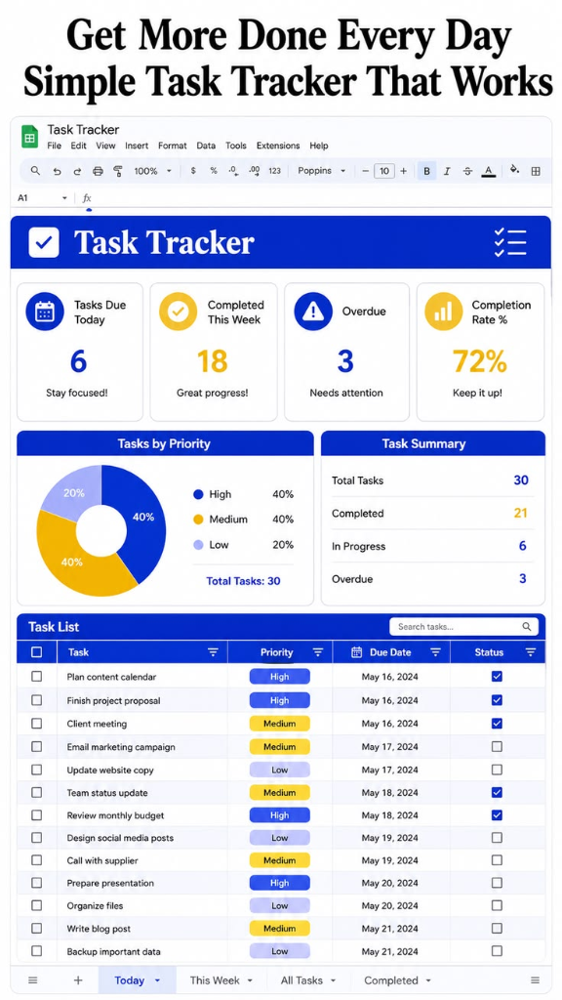

# 📋 Task Tracker - Get More Done Every Day

A modern, responsive, and interactive Task Management Web Application inspired by Google Sheets and modern productivity dashboards.



---

## ✨ Features

- **📊 4 Dynamic KPI Metric Cards**:
  - **Tasks Due Today** with focused subtext
  - **Completed This Week** progress tracking
  - **Overdue Tasks** alert
  - **Completion Rate %** calculated in real time
- **🍩 Tasks by Priority Donut Chart**:
  - Interactive HTML5 Canvas donut chart visualizing task distribution across **High** (Blue), **Medium** (Amber), and **Low** (Periwinkle) priorities with dynamic percentage readouts.
- **📈 Task Summary Breakdown**:
  - Live counts for Total Tasks, Completed, In Progress, and Overdue.
- **📝 Full CRUD Task Management**:
  - Create new tasks with description, priority, and due date.
  - Interactive status checkbox button (toggles completion status with instant metric recalculation).
  - Edit existing tasks via modal dialog.
  - Delete individual tasks.
  - Multi-select bulk actions (Mark Multiple Completed or Bulk Delete).
- **🔍 Real-Time Search & Priority Filter**:
  - Instant live search by task title.
  - Dropdown filter by priority (High, Medium, Low, All).
  - Sortable table columns (Task, Priority, Due Date, Status).
- **📑 Sheets-Style Navigation Tabs**:
  - Filter views instantly: **All Tasks**, **Today**, **This Week**, **In Progress**, **Completed**, and **Overdue**.
- **💾 Local Persistence & JSON Export**:
  - Saves your tasks automatically to browser `localStorage`.
  - **Reset Demo** button to restore the original 30 sample tasks anytime.
  - **Export JSON** button to download a backup file of your tasks.
- **🐍 Python CLI Version**:
  - Includes `todo.py` for terminal-based task management using Python 3.10+ `match-case`.

---

## 🛠️ Tech Stack

- **HTML5**: Semantic markup, modal components, and HTML5 Canvas.
- **CSS3**: Custom design system with CSS Variables, Flexbox, CSS Grid, animations, and responsive media queries.
- **JavaScript (ES6+)**: Reactive state management, Canvas 2D rendering, localStorage persistence, and DOM event handling.
- **Python 3**: Console CRUD to-do list (`todo.py`).

---

## 🚀 How to Run

### Web Application
Simply open `index.html` in any modern web browser:
```bash
# Using Python's built-in HTTP server:
python3 -m http.server 8000
```
Then visit `http://localhost:8000` in your browser.

### Terminal Application
Run the Python script directly:
```bash
python3 todo.py
```

---

## 👤 Author

**Kritideepta Paul**
- GitHub: [@KritideeptaPaul](https://github.com/KritideeptaPaul)
